# TimeGAN - a Limit Order Book Simulation

## Introduction
The aim of this project is to develop, train and evaluate a generative machine learning model 
capable of recreating temporal dynamics and relationships, particularly with limit order books 
(LOBs). Limit order books are financial records that track the price and volume of the top asks 
and bids of a company's stocks at certain timestamps throughout the day. This project will use 
level 10 AMAZON LOB data meaning only the best 10 asks and bids will be considered where the 
best ask and bid is level 1. The goal is to use machine learning to generate synthetic limit 
order books with financial plausibility and realism using sample data. The ML model chosen for this 
task is the TimeGAN, an adversarial network capable of generating time-series samples proposed 
by Yoon et al. in the 2019 Time-series Generative Adversarial Networks paper.

### TimeGAN Architecture Overview
TimeGAN features the traditional GAN's generator-discriminator adversarial learning with 
supervised temporal learning to generate synthetic time series data by sampling from noise. 
Overall, TimeGAN requires five components: the Embedder, Recovery network, 
Generator, Supervisor, and Discriminator (Yoon et al., 2019). Each component uses a two-layer Gated 
Recurrent network (GRU), a simplified type of recurrent neural network (RNN), with a hidden 
dimension of 128 (GeeksforGeeks, 2019). The Embedder learns how to transform the original data's 
features into a latent representation and the Recovery network learns how to undo this, 
transforming latent representations back into its original feature space. The Generator produces 
synthetic latent sequences from randomly sampled noise while the Discriminator attempts to 
learn which sequences produced are real or fake. Finally, the Supervisor encourages sequences 
generated by the Generator to follow realistic limit order book changes over time, thus 
preserving temporal dynamics. TimeGAN training consists of three stages: embedder-recovery 
pretraining, supervisor pretraining and joint adversarial training.

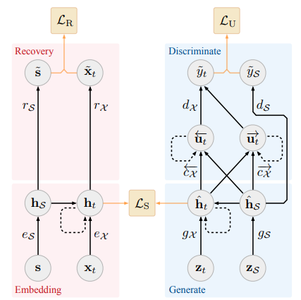

Figure 1: TimeGAN Architecture Proposed by Yoon et al.

## Feasibility Review

**1. User Need, Scope & Acceptance Criteria**

Synthetic LOB (limit order book) data is valuable for quantitative stock traders who are 
interested in developing and validating effective algorithmic strategies. It allows traders to 
evaluate their models on a plausible imitation before taking actual financial risks. Training on 
only real-world data can lead to overfitting on one historical dataset and training on synthetic 
data can help mitigate this by introducing variation on the observed market.

Plausible LOB data must follow a set of acceptance criteria: no crossed or locked books exist 
(the best bid must always be lower than the best ask), the ask ladder must monotonically 
increase with level, the bid ladder must monotonically decrease with level, volumes of all ask 
and bid sizes must be non-negative, produce authentic volatility clustering (big moves are 
followed by big moves and small moves are followed by small moves), produce heavy-tailed 
return distributions (clear positive excess kurtosis and tail quantiles match the real data to 
some degree), have a KL (Kullback-Leibler) divergence of ≤ 0.1 on spread and mid-price returns 
and a SSIM (structural similarity) > 0.6 on depth heatmaps (price levels × time steps).

**2. Model Choice & Course Concepts**

The model of choice will be a generative adversarial network (GAN), specifically a TimeGAN. A 
TimeGAN extends the traditional GAN by introducing the embedding/recovery space and two 
important losses: LS (supervised loss), and LR (ensures the embedding preserves enough 
information needed to accurately reconstruct real data, allowing latent representations to be 
meaningfully decoded) (Yoon et al., 2019). The goal of the TimeGAN is to preserve temporal 
dynamics by learning from both real history and the entire generated sequence (using LU) to pick 
up on transitional and holistic failure.

As for each module’s architecture, the embedding network, generator and discriminator will 
likely need to be RNNs (recurrent neural networks) whereas the recovery network can be 
feedforward because each latent vector already has the temporal context needed for 
reconstruction (Yoon et al., 2019).

The LOBSTER AMZN Level 10 dataset itself features 10 price levels where level one is the lowest 
ask and the highest bid; level two is the second lowest ask and the second highest bid and so on.
Each level contains ask price, ask volume, bid price and bid volume, totalling 40 columns 
(number of details per level × number of levels) for every entry. Each entry marks an event that 
occurred at a specific time.

The TimeGAN is a hard difficulty project.

**3. Preliminary Feasibility Evidence**

As a baseline, a TimeVAE inspired model has been created based on Desai et al.'s 2021 paper: 
_TimeVAE: a Variational Auto-Encoder For Multivariate Time Series Generation_. 
Running this model on the sample data (AMZN level 10 data on one day) and over five epochs as a 
smoke test, the model successfully 
exhibited the ability to learn. Its validation loss began at 1831.0 and dropped to 1612.0 in 
these five epochs which took 4 mins and 2 secs. This smoke test reveals that the dataset is 
workable.

**4. Risks, Budget & Fallback**

The main risk of a TimeGAN is its adversarial nature possibly leading to unstable training and 
collapse. In GANs, the generator can possibly overpower the discriminator causing the 
discriminator to recognise every sample as real, or the discriminator can overpower the 
generator where the discriminator successfully catches every fake sample leaving no opportunity 
for the generator to learn what’s realistic. Due to this difficultly, training time may be long 
and could ultimately result in failure.

Computing budget wise, training should be able to succeed on one rangpur GPU with 16GB of 
memory. Runtimes will be limited in SLURM scripts and will be adjusted appropriately (with 
buffer) based on epochs. 

The next planned experiment will be running the baseline model for more epochs and visualising 
its samples. If these are successful according to the acceptance criteria discussed in section 1., 
development of the TimeGAN can begin.

A realistic fallback in case of the TimeGAN’s failure or unfeasible training requirements, would 
be to simplify the architecture proposed by Yoon et al. and instead return to just a 
generator-discriminator model where time series relationships are still learnt. This would be 
more similar to the C-RNN-GAN or RCGAN that Yoon et al. proposed.

## Dependencies
Below are the list of dependencies in 'name - version - use' format
1. Python - 3.11.15 - programming language
2. PyTorch - 2.13.0 - machine learning library
3. NumPy - 2.4.6 - numerical operations
4. scikit-learn - 1.9.0 - feature standardisation
5. SciPy - 1.17.1 - statistical evaluation
6. scikit-image - 0.26.0 - SSIM evaluation
7. Matplotlib - 3.11.1 - data visualisation
8. Joblib - 1.6.0 - normaliser persistence

Training was completed on UQ's Rangpur cluster using NVIDIA A100 GPU with VRAM of 40GB

## Reproducibility
Evaluation metrics are fully reproducible as model weights are saved after training and random 
sampling seed is fixed for numpy and pytorch. Training reproducibility is not guaranteed as 
model weights are randomised on initialisation and dataloaders shuffle batches.

## Inputs, Outputs and Visualisations of TimeGAN
### Inputs
The TimeGAN receives raw LOBSTER AMAZON Level 10 data as input. From left to right each column 
represents level 1 ask price, level 1 ask volume, level 1 bid price, level 1 bid volume, level 2 
ask price, and so on until level 10. Each level has four features resulting in 40 columns. 
Prices are given in 1c = 100 unit conversion so 1c = 100 and $1 = 10000. Volumes represent the 
number of shares corresponding to that ask or bid. The rows represent order book events in 
chronological sequence. Below is a small snippet of the input .csv file where the first 36 
events can be observed up to level 6 in the order book.

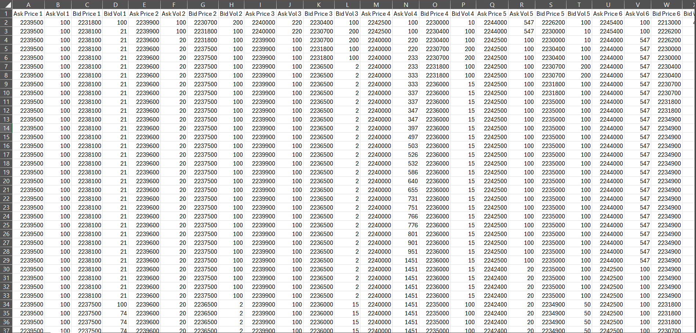

Figure 2: Example LOBSTER Input

```
def load_orderbook(path):
    # LOBSTER orderbook files have no header: 40 columns, one row per event
    return np.loadtxt(path, delimiter=",", dtype=np.float64)
```
The .csv file is transformed into a numpy array for preprocessing.

### Outputs
The TimeGAN outputs generated synthetic sequences where every individual event has 40 generated 
features that can be inversely transformed back to limit order book form using a saved 
normaliser and reconstructed mid-prices. These sequences contain 64 consecutive events and we 
can choose to generate as many sequences as necessary for evaluation. In this project 2000 
sequences are used for evaluation. These sequences are independent from one another as the 
TimeGAN learns temporal dynamics over a single 64-event window, not over several windows.

Below are the first 10 events of a reconstructed synthetic generation. Only level 1 (best 
ask/bid) is depicted and prices have been converted to dollar amounts.

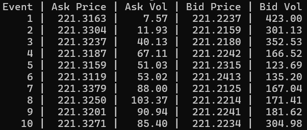

Figure 3: Example LOBSTER Output

### Visualisations
To visualise a single output window, we can graph price movements and volume changes over 64 
consecutive events and the 10 levels

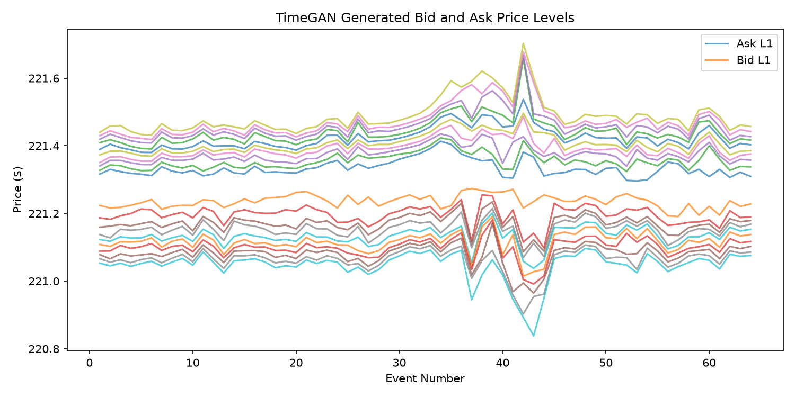

Figure 4: Example LOBSTER Price Movement Over 64 Events

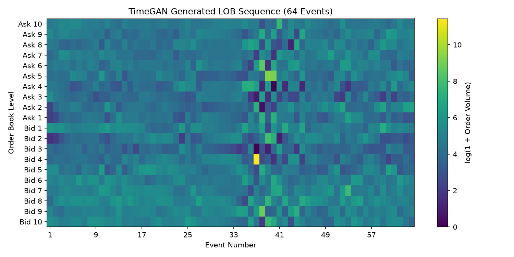

Figure 5: Example LOBSTER Volume Changes Over 64 Events

## Data Preprocessing
Preprocessing on raw LOB data is important to improve training stability and also some 
transformations to the data can make it easier for the model to learn certain relationships.

### Price Gaps
The choice to use price gaps between levels instead of raw ask/bid prices was important as it 
helps the model learn relationships between levels instead of possibly treating each level as 
isolated. This was calculated by taking the difference between each level at every time step. We 
divide by CENT = 100 here since LOB data represents data such that 1 cent is 100 units.
```
ask_p, ask_v = X[:, 0::4], X[:, 1::4]
bid_p, bid_v = X[:, 2::4], X[:, 3::4]

ask_gap = np.diff(ask_p, axis=1) / CENT
bid_gap = -np.diff(bid_p, axis=1) / CENT

prices = np.log(np.concatenate([ask_gap, bid_gap], axis=1))
```
There are 10 levels for asks and bids each step resulting in 9 ask price gaps and 9 bid price 
gaps meaning 18 price gap features every step. We take the log of these price gap values to 
reduce the influence of outlier values on training.

### Ask-Bid Spread
Another feature that was deemed important for the model to learn separately was the spread value 
of every step. Spread is the difference between the best ask and best bid where 'best' means 
level 1. This captures the separation between buying and selling prices and is important for 
evaluation metrics.
```
spread = (ask_p[:, 0] - bid_p[:, 0]) / CENT

np.log(spread)
```
Here, we're taking the difference between the ask price and bid price on the first column which 
corresponds to level 1. Then, again taking the log for the same reason as above.

### Mid-Price Returns
Similarly to spread, mid-price returns is another feature required for evaluation and helps the 
model learn price movements between consecutive events. Mid-price is the average price between 
the best ask price and best bid price and mid-price returns is how much the mid-price changed 
from the last event.
```
mid = (ask_p[:, 0] + bid_p[:, 0]) / 2

ret = np.diff(np.log(mid), prepend=np.log(mid[0]))
```
Here, we first prepend 0 to the first mid-price return since the first entry does not have a 
previous event to calculate change from. We take the log of the mid-price to preserve relative 
price changes instead of absolute changes. For example, 10 increasing to 20 
is only a flat 10 change, but is actually a 100% increase, whereas 1000 increasing to 1010 is the 
same flat increase but only a 1% increase.

### Order Volumes
Order volume is how many shares are associated with a certain ask/bid and is an important 
feature of market movement. Each time step will have 20 order volume values, 10 for asks level 
1-10 and 10 for bids level 1-10.
Order volumes are always non-negative but could be zero which is why we use log(1 + x) i.e. log1p 
in code to handle this zero as log(0) is invalid. Here, taking the log of the volume value also 
helps reduce the influence that extremely large outlier volumes will have on training.
```
volumes = np.log1p(np.concatenate([ask_v, bid_v], axis=1))
```

### Standardisation
Standardisation is an important step that ensures all values affect training equally regardless 
of their unit or scale. For example, price may range from 1000-100000 whereas volume may only 
have a range of 0-2000. Without standardisation, price may influence the model's training and 
loss function more than volume as its flat values are of larger magnitude. Standardisation 
ensures a mean of 0 and standard deviation of 1. This ensures values affect the model in 
relation to other values of the same feature.
```
# Calculate and store statistics for standard distribution
self.p_scaler = StandardScaler().fit(P)           # Price gaps (18 features)
self.v_scaler = StandardScaler().fit(V)           # Volumes (20 features)
self.s_scaler = StandardScaler().fit(S[:, None])  # Spread (1 feature)
self.r_scaler = StandardScaler().fit(R[:, None])  # Mid-price returns (1 feature)

# Transform data using corresponding statistics and concat into standardised feature matrix
Z = np.concatenate([
    self.p_scaler.transform(P),
    self.v_scaler.transform(V),
    self.s_scaler.transform(spread[:, None]),
    self.r_scaler.transform(ret[:, None]),
], axis=1).astype(np.float32)
```
In the code, scikit-learn's StandardScaler function does this for us. The final feature count 
for a single event is 40: 9 ask price gaps, 9 bid price gaps, 10 ask volumes, 10 bid volumes, 1 
spread, 1 mid-price return.

### Windowing
Since the TimeGAN learns on time series data, it must be able to learn on a sequence of events 
where each event contains the 40 features listed above. This is where windowing comes in. A 
64-event window was chosen with a stride of 8 meaning the TimeGAN will process 64 events at once 
and afterwards will shift to the next 64-event window, 8 events over resulting in a 56-event 
overlap. This strategy is incredibly important for preserving temporal relationships in the 
dataset.

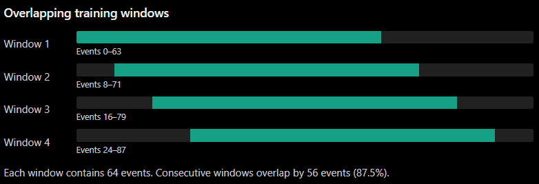
Figure 6: Graphic depicting Dataset Windowing (generated by ChatGPT-5)

```
def __init__(self, Z, mid, window=64, stride=8):
    if window <= 0 or stride <= 0:
        raise ValueError("window and stride must be positive")
    if len(Z) < window:
        raise ValueError("Not enough events for one window")

    self.Z = torch.from_numpy(Z)
    self.mid = torch.from_numpy(mid.astype(np.float64))
    self.window, self.stride = window, stride
    self.n = (len(Z) - window) // stride + 1
```
When training, the dataloader will load in batches where a batch will contain 64 windows, 
each window containing 64 events and each event with 40 features. 

### Train, Validation, Test Split
For model training and evaluation, a 70:15:15 train-validation-test chronological split was 
chosen. This means the first 70% of rows were used for training, the next 15% were for 
validation and the final 15% were for testing. We choose chronological splitting instead of 
random splitting (common in other MLPs) to preserve the dataset's time ordering. 
This makes sense for time series data, such as LOBs, where the goal is to produce synthetic 
sequences based on past data. This time-based splitting allows us to treat the first 70% of data 
as 'seen' historical observations and the rest as 'unseen' future data that we can evaluate 
performance against. The validation set is used for model selection and monitoring training 
performance, while the test set is a final evaluation of the synthetic samples' financial 
plausibility.

## Evaluating TimeGAN  ver. 1
To evaluate how well the TimeGAN performed, i.e. how realistic its generated sequences were, we 
use quantitative metrics derived from the acceptance criteria specified in the 
feasibility review. Then, we can compare TimeGAN's metrics to the baseline model's (TimeVAE) to 
see what aspects it performed better at and worse at.

### Financial Validity
The first set of metrics determine if the generated sequences are financially valid. We check if 
the synthetic outputs are violating hard constraints on limit order books. Metrics will be 
recorded as a violation percentage calculated by (events with violations)/(total number of 
events). Remember, 2000 windows were generated each with 64 events totalling 128,000 events. 
Here, we will also introduce the tick, which is the minimum amount a price can move up or down by, 
which is 1 cent in the American stock market.

Before we begin analysis, there's an important disclaimer to be made. Spread, price gaps and 
volume can be learned by the model as an invalid value i.e. less than 1 tick for spread and gaps 
and negative for volume. These values are corrected during post-processing (transform generated 
sequences back to limit order book form) to produce artefacts that do not violate hard rules. 
This means some metrics can be calculated before post-processing to discover purely what the model 
learned, but other metrics (particularly VWAP and SSIM) require the generated sequences to be 
transformed back into limit order book form to compare with real data.

The below violation percentages are all calculated before post-processing as afterwards, these 
will all become 0%. 

| Metric                                | Real | TimeGAN  | TimeVAE  |
|---------------------------------------|------|----------|----------|
| Locked/crossed book (spread < 1 tick) | 0%   | 0.00078% | 0.01328% |
| Invalid ask ladder (gap < 1 tick)     | 0%   | 82.92%   | 37.90%   |
| Invalid bid ladder (gap < 1 tick)     | 0%   | 79.98%   | 35.95%   |
| Negative volume                       | 0%   | 1.632%   | 0.0523%  |

Firstly, both models had relatively high violations when it came to the ask ladder being strictly 
increasing and the bid ladder being strictly decreasing. Recall that every event has 9 ask gaps 
and 9 bid gaps and if a single one of these values is lower than 1 tick, the whole event will be 
treated as a violation. The example below illustrates this.

| Level      | 1  | 2  | 3  |
|------------|----|----|----|
| Ask Prices | 30 | 32 | 35 |
| Bid Prices | 20 | 21 | 17 |

The ask prices are strictly increasing as level increases, therefore no violation so far. 
However, bid prices increase from level 1 to level 2 even though it decreases again at level 3. 
This single violation (bid 1 -> bid 2) would mark this whole event as a violation.

Overall, the baseline model outperforms the TimeGAN at learning ask/bid ladder structure and 
that volumes are non-negative by having much lower violation percentages in those metrics. The 
TimeGAN is better at producing non-locked/crossed books having only 0.00078% of entries 
violating the constraint whereas the TimeVAE had 0.01328% violation.

### KL Divergence on Spread and Mid-price Returns
KL divergence is a measure of different two distributions are with a score of 0 meaning 
identical distributions. The goal is to generate synthetic samples with a distribution on spread 
and mid-price returns as close to the real data as possible as this means the model successfully 
learned the actual market's distributions. 

| Metric                          | TimeGAN | TimeVAE |
|---------------------------------|---------|---------|
| Spread KL Divergence            | 0.2927  | 0.4949  |
| Mid-price Returns KL Divergence | 1.4173  | 0.7733  |

The TimeGAN did a better job at replicating the distribution of spread values whereas the 
baseline model outperformed the TimeGAN when learning the distribution of mid-price returns. 

Taking a closer look at spread distribution in particular, we get the below table where values 
are given as ticks. We interpret it as, 50% of spread values in the real data are 9 ticks or 
lower whereas 50% of spread values in the TimeGAN generated data are 12.30 ticks or lower. 
This means the TimeGAN tends to produce higher spread values more frequently than a real limit order 
book.

| Statistic                | Real   | TimeGAN | TimeVAE |
|--------------------------|--------|---------|---------|
| Minimum                  | 1.00   | 0.92    | 0.57    |
| Median (50th percentile) | 9.00   | 12.30   | 13.82   |
| 90th percentile          | 16.00  | 21.34   | 18.36   |
| 95th percentile          | 17.00  | 24.70   | 19.78   |
| 95th percentile          | 20.00  | 32.61   | 23.10   |
| Maximum                  | 24.00  | 111.40  | 41.08   |

We see that TimeGAN produces spread values closer to the real distribution near the median, 
whereas the baseline model performs better in upper percentiles. Both models tend to produce 
higher spread values more frequently than they realistically should, but the TimeGAN overall 
performs better considering its lower KL divergence as well.

### VWAP
VWAP (Volume Weighted Average Price) is a way to calculate the average price of all asks and 
bids in an entry while weighting by volume so orders with higher volume matter more. It is 
calculated like so:

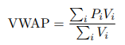

Where i = level (1-10), P = price, V = volume.

VWAP can be used to estimate how offset asks and bids are from the mid-price which allows us to 
evaluate how well models can reproduce the price and volume structure of real LOBs. With every 
entry having an associated VWAP for ask and bid, we can create a distribution on the difference in 
ticks between VWAP values and their corresponding mid-price. We interpret the below table as, on 
average, real ask VWAPs are higher than the mid-price by 13.1633 ticks with a variance of 8.8733 
ticks<sup>2</sup>. Furthermore, the TimeGAN's bid VWAPs are lower than the mid-price by 16.5922 
ticks on average with a variance of 19.8114 ticks<sup>2</sup>.

| Statistic                | Real    | TimeGAN    | TimeVAE  |
|--------------------------|---------|------------|----------|
| Ask VWAP offset mean     | 13.1633 | 16.1711    | 15.6983  |
| Ask VWAP offset variance | 8.8733  | 19.8297    | 9.4046   |
| Bid VWAP offset mean     | 13.0013 | 16.5922    | 15.8360  |
| Bid VWAP offset variance | 7.1712  | 19.8114    | 9.8252   |

The baseline model performs slightly better at reproducing realistic mean VWAP offset values and 
performs much better at modelling VWAP offset variance where its values (9.4046 for asks, 9.8252 
for bids) are much closer to the real data's values (8.8733 for asks, 7.1712 for bids) than 
TimeGAN's is. TimeGAN's offset variance values are much higher suggesting the price 
and volume structure in TimeGAN's generations may be too volatile to model a realistic LOB.

### Temporal Dynamics - Autocorrelation
Autocorrelation is a metric we can use to evaluate how strongly data is related to itself in the 
past i.e. some number of events ago also known as lag (a lag of 1 compares two consecutive events, 
whereas a lag of 10 measures relatedness of two events 10 apart).
We can compare our generative model's autocorrelation 
values to the real data's values to see if similar temporal relationships are being learned. 
Autocorrelation is a value from -1 to 1, where -1 means strong negative relationship, 0 means no 
linear relationship and 1 means strong positive relationship. 

First, observing TimeGAN's autocorrelation against real data.
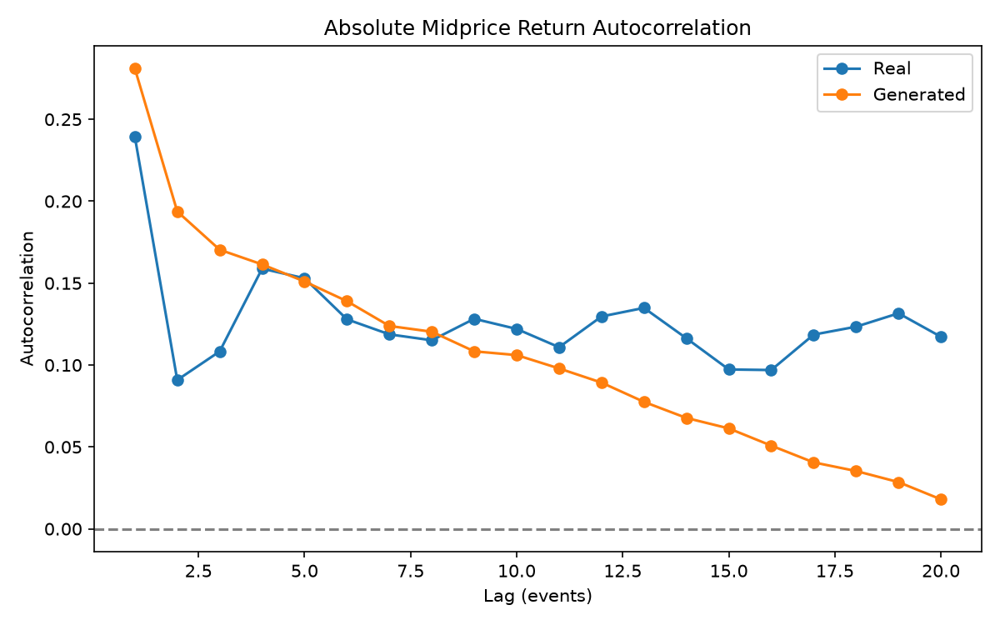

Figure 7: TimeGAN vs Real Autocorrelation

Here, both the TimeGAN and real data have relatively strong positive relationship between 
consecutive events, but TimeGAN's autocorrelation steadily falls (almost to 0) as events lag 
further apart. In the real data, relatedness quickly drops off and stagnates around 0.1 to 0.15. 
TimeGAN picks up that events close together should be related but fails to maintain this with 
two events around 8 or more apart.

The TimeVAE on the other hand, produces wild oscillating autocorrelation values with negative 
values at odd lags and quite high positive values at even lags. Further, investigation is 
required to pinpoint the root of this behaviour but because the baseline model is not the focus 
of the project, the current verdict is that the TimeGAN does a better job at modelling the 
relatedness of sequential events.

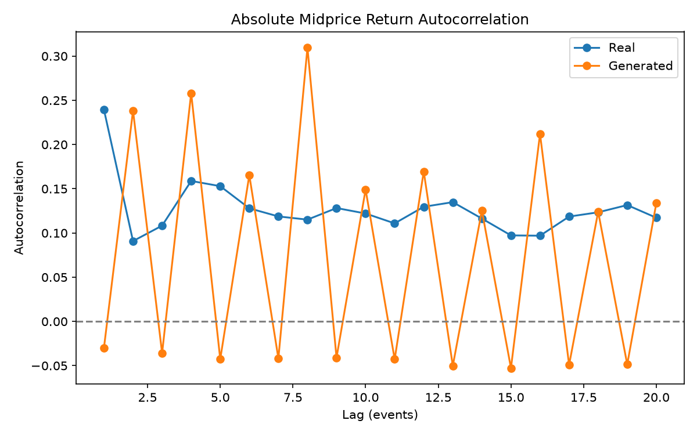

Figure 8: TimeVAE vs Real Autocorrelation

### Heavy-tailed Return Distributions
In real market conditions, stock prices are frequently volatile and the mid-price distribution 
often does not reflect a normal distribution. With extreme outlier stock prices occurring more 
frequently (market crashes/surges), our model needs to be able to reproduce this behaviour.
Excess kurtosis is a metric that measures the shape of a distribution. A normal distribution has 
an excess kurtosis of 0, 
a positive value means the distribution has heavier tails and a spikier centre compared 
to the normal distribution, and a negative value means lighter tails with a flatter centre. 
Naturally, we expect stock data to have a positive excess kurtosis since outliers occur more 
frequently which correspond to heavy tails.

This is confirmed as the real data has an excess kurtosis of 57.6905 which is considered 
extremely high suggesting the provided AMAZON data is extremely volatile. Both models produced a 
positive excess kurtosis (TimeGAN - 2.1267, TimeVAE - 2.0943), but neither fully captured the 
extremity of the real data's distribution.

| Statistic        | Real    | TimeGAN | TimeVAE |
|------------------|---------|---------|---------|
| Excess Kurtosis  | 57.6905 | 2.1267  | 2.0943  |

This metric comes with a major caveat as in the real data a majority of the time mid-price does 
not change resulting in many zero return values, and when changes do occur, they are comparatively 
extreme to the typical zero or near-zero returns. This may explain the excess kurtosis of 57.6905.

### Structural Similarity - SSIM
Structural Similarity Index Measure (SSIM) is a measure of how similar two images are based on 
pixel brightness, contrast and contrast. To perform SSIM on LOB data, we create and compare order 
volume heatmaps over a set of events for both the real data and synthetic data from the models. 
SSIM score ranges from -1 to 1 where 1 is an identical copy.

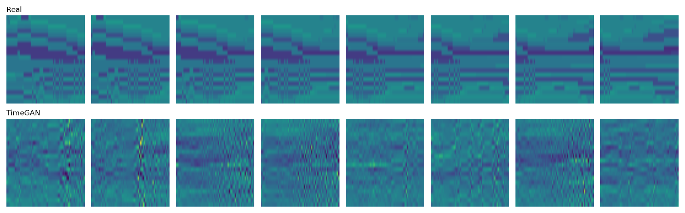

Figure 9: Generated TimeGAN Order Volume Heatmaps vs Real Order Volume Heatmaps

 
The table below shows the average SSIM score after comparing 300 one-to-one pairs of heatmaps. 
For example, TimeGAN vs Real means 300 TimeGAN heatmaps were paired up with 300 real data 
heatmaps where each pair was compared and a SSIM score was produced. The average of these 300 
scores resulted in 0.0830 which is considered very low.

| Comparison           | SSIM   |
|----------------------|--------|
| Real vs Real         | 0.1150 |
| TimeGAN vs Real      | 0.0830 |
| TimeVAE vs Real      | 0.1104 |

SSIM is not a very useful metric for limit order books 
since two completely different snapshots of the market at different times can both be valid.
The Real vs Real metric demonstrates this perfectly as 300 real heatmaps compared to 300 other 
real heatmaps only produced an average SSIM score of 0.1150.
This is far from the target of 0.6 even though all comparisons were between two real and valid 
order book snapshots.

Neither model performed well here and combined with SSIM's limitations, this metric will not be 
considered in evaluation.

### Computational Efficiency
The baseline model exhibited both a lower training time and peak GPU memory usage and is thus 
the more computationally efficient model under the current training configuration.

| Metric              | TimeGAN       | TimeVAE     |
|---------------------|---------------|-------------|
| Training Time       | 20 min 20 sec | 5 min 7 sec |
| Peak GPU VRAM Usage | 830 MB        | 618 MB      |


### Final Comparison
Now, summarising which model performed better in which aspect, we produce the table below:

| Evaluation Metric                  | Stronger Model         |
|------------------------------------|------------------------|
| Financial Validity                 | TimeVAE overall        |
| KL Divergence on Spread            | TimeGAN                |
| KL Divergence on Mid-price Returns | TimeVAE                |
| VWAP Statistics                    | TimeVAE                |
| Autocorrelation                    | TimeGAN                |
| Heavy-tail Modelling               | Neither satisfactorily |
| SSIM                               | Not considered         |
| Computational Efficiency           | TimeVAE                |

The baseline model outperformed the TimeGAN on most evaluation metrics except for KL on spread 
and autocorrelation. Additionally, neither model performed well at reproducing the real data's 
heavy-tailed distribution on mid-price returns.

Currently, the TimeGAN does not demonstrate a substantial improvement over the baseline 
model under the current evaluation metrics. Modifications will be made to the model in an 
attempt to improve its performance. 

## Evaluating TimeGAN ver. 2

### Version 1 Failure Cases
TimeGAN ver. 1 struggled particularly at producing consistent valid ask and bid ladders. 82.92% 
of generated events had at least one violation of the strictly increasing ask ladder constraint,  
and 79.98% of events had at least one violation of the strictly decreasing bid ladder constraint.
It also consistently produced higher VWAP offset mean and variance values compared to the real 
data and baseline model meaning it is not capturing realistic market volatility. Finally, both 
models really struggled with learning the heavy-tailed mid-price returns distribution of the real 
data making this metric a key area to improve.

### Proposal for Improvement
The clearest weakness in TimeGAN ver. 1 with the most actionable improvement is reducing the 
number of ask/bid ladder violations. The baseline model greatly outperformed TimeGAN in this 
department and financial validity is the metric that objectively tells us if our model reproduced 
a valid limit order book.

The improvement will consist of introducing a penalty in the generator's loss function that 
specifically targets price gaps below 1 tick.

```
def price_gap_penalty(x_fake, gap_mean, gap_scale):
    # Convert standardised generated gaps back to log values
    log_gaps = x_fake[:, :, :18] * gap_scale + gap_mean

    # Penalise gaps below one tick (log-gap < 0)
    return torch.relu(-log_gaps).mean()
```
TimeGAN does not generate price gaps directly, instead it generates standardised log price gaps. 
We first have to undo the standardisation before checking valid price gaps resulting in just log 
price gaps. We want to penalise price gaps less than 1 therefore, we penalise log price gaps 
less than 0 since log(1) = 0. Then using a ReLu, we can increase the penalty based on how major the 
violation was. Taking the mean then produces one penalty value for the whole 64-event window.

### Evaluation
After running TimeGAN ver. 2, the evaluation metrics turned out as so:

| Metric                                | Real  | TimeGAN v1 | TimeGAN v2 | Stronger Model |
|---------------------------------------|-------|------------|------------|----------------|
| Locked/crossed book (spread < 1 tick) | 0%    | 0.00078%   | 0%         | v2             |
| Invalid ask ladder (gap < 1 tick)     | 0%    | 82.92%     | 85.39%     | v1             |
| Invalid bid ladder (gap < 1 tick)     | 0%    | 79.98%     | 85.22%     | v1             |
| Negative volume                       | 0%    | 1.632%     | 0.359%     | v2             |
| KL Divergence Spread                  | 0     | 0.2927     | 0.5162     | v1             |
| KL Divergence Mid-price Returns       | 0     | 1.4173     | 1.4336     | v1             |
| Ask VWAP mean                         | 13.16 | 16.17      | 16.20      | v1             |
| Ask VWAP variance                     | 8.87  | 19.83      | 23.96      | v1             |
| Bid VWAP mean                         | 13.00 | 16.59      | 16.31      | v2             |
| Bid VWAP variance                     | 7.17  | 19.81      | 19.83      | v1             |
| Excess Kurtosis                       | 57.69 | 2.13       | 5.21       | v2             |
| SSIM (model vs real)                  | 0.115 | 0.0830     | 0.0829     | Neither        |

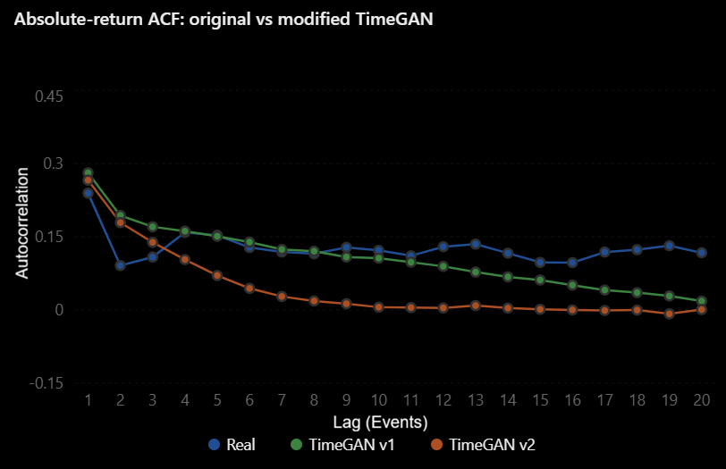

Figure 10: TimeGAN v1 vs v2 vs Real Autocorrelation

Unexpectedly, penalising the TimeGAN on price gaps below 1 tick actually resulted in higher 
violation percentages when it came to invalid ask and bid ladder. Invalid ask ladder violations 
rose from 82.92% to 95.39%. Invalid bid ladder violations rose from 79.98% to 85.22%. 
On the other hand, locked/crossed book violations dropped to 0% and negative volume violations 
also dropped substantially from 1.632% to 0.359%.

In most other metrics, the two models 
performed very similarly besides excess kurtosis and autocorrelation. TimeGAN v2 produced a 
much higher excess kurtosis value at 5.21 compared to v1 at 2.13. This still is not anywhere 
near the real data's 57.69 but is a step closer. For autocorrelation, the figure above reveals 
that v2 performed a lot worse than v1 at reproducing the temporal dynamics of the real data. 
V2's autocorrelation value falls off to 0 much earlier showing that it is not able to model the 
relatedness of consecutive events.

Unfortunately, v2 does not present as a substantial upgrade to v1 and this may be due to many 
reasons. 

1. The penalty may have been too weak having only been given a weight of 10 whereas others such 
   as supervisor loss and moment matching loss were weighed much heavier at 100. If this 
   hypothesis is true, that means the penalty would have had very little influence over training 
   and the differences in performance observed can mostly be attributed to the stochastic nature of 
   training.
```
loss_g = (
        loss_adv
        + gamma * loss_adv_raw
        + 100 * torch.sqrt(loss_s + 1e-8)
        + 100 * loss_m
        + 10 * price_gap_penalty(x_fake, gap_mean, gap_scale)
)
```
2. The penalty optimised only on price gap magnitude and not violation frequency. For example, 
   the model learning to increase a price gap from 0.2 ticks to 0.9 ticks reduces the penalty 
   substantially, but 0.9 is still less than 1 tick and counts as a violation.

To find out if the penalty was weighted too lightly we can run training again with these debug 
print statements:
```
print(f"Weighted gap penalty: {(10 * price_gap_penalty(x_fake, gap_mean, gap_scale)).item():.6f}")
print(f"Moment contribution: {(100 * loss_m).item():.6f}")
```
This will reveal how much the newly introduced penalty is actually contributing to the total 
generator loss. After training, the resulting weighted contribution values were:

| Loss Component       | Typical Weighted Contribution Range |
|----------------------|-------------------------------------|
| Price-gap Penalty    | 0.5-0.8                             |
| Moment Matching Loss | 10-20                               |
| Total Generator Loss | 23-27                               |

These values reveal that the introduced price-gap penalty is only fractionally contributing to the 
total generator loss compared to the moment matching loss and an increase in weighting would be 
justified. As an experiment, the penalty's weighting will be increased to 100 matching the other 
losses that contribute to the total generator loss.

```
loss_g = (
        loss_adv
        + gamma * loss_adv_raw
        + 100 * torch.sqrt(loss_s + 1e-8)
        + 100 * loss_m
        + 100 * price_gap_penalty(x_fake, gap_mean, gap_scale)
)
```

## Evaluating TimeGAN ver. 2.1
After updating the weight from 10 to 100 for the penalty, the new model (TimeGAN v2.1) produced 
the below results:

| Metric                                | Real  | TimeGAN v1 | TimeGAN v2 | TimeGAN v2.1 | Stronger Model |
|---------------------------------------|-------|------------|------------|--------------|----------------|
| Locked/crossed book (spread < 1 tick) | 0%    | 0.00078%   | 0%         | 0%           | v2 and v2.1    |
| Invalid ask ladder (gap < 1 tick)     | 0%    | 82.92%     | 85.39%     | 54.48%       | v2.1           |
| Invalid bid ladder (gap < 1 tick)     | 0%    | 79.98%     | 85.22%     | 49.62%       | v2.1           |
| Negative volume                       | 0%    | 1.632%     | 0.359%     | 0.694%       | v2             |
| KL Divergence Spread                  | 0     | 0.293      | 0.516      | 0.466        | v1             |
| KL Divergence Mid-price Returns       | 0     | 1.417      | 1.433      | 1.086        | v2.1           |
| Ask VWAP mean                         | 13.16 | 16.17      | 16.20      | 18.32        | v1             |
| Ask VWAP variance                     | 8.87  | 19.83      | 23.96      | 356.51       | v1             |
| Bid VWAP mean                         | 13.00 | 16.59      | 16.31      | 17.51        | v2             |
| Bid VWAP variance                     | 7.17  | 19.81      | 19.83      | 72.09        | v1             |
| Excess Kurtosis                       | 57.69 | 2.13       | 5.21       | 14.96        | v2.1           |
| SSIM (model vs real)                  | 0.115 | 0.0830     | 0.0829     | 0.0796       | None           |

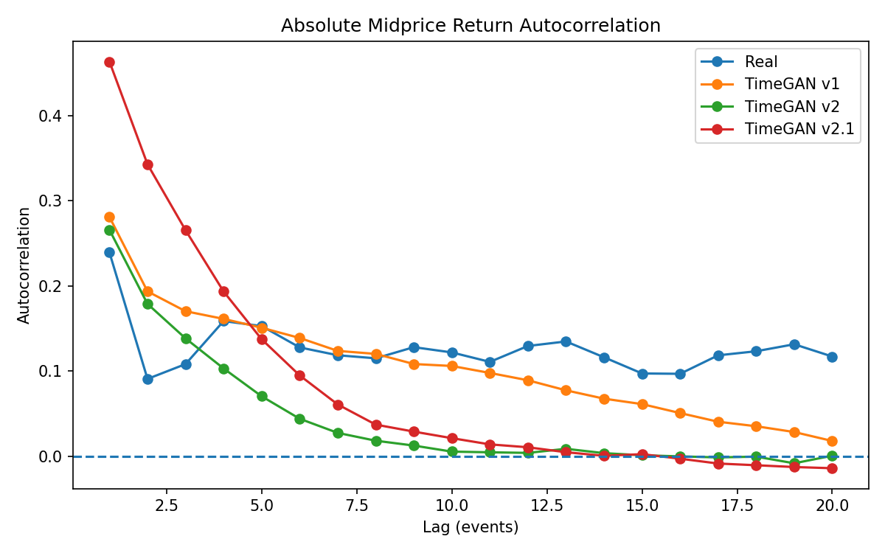

Figure 11: TimeGAN v1 vs v2 vs v2.1 vs Real Autocorrelation

TimeGAN v2.1 showed that increasing the penalty in price-gaps did result in the intended effect.
Invalid ask ladder percentage dropped from 85.39% to 54.48% and invalid bid ladder percentage 
dropped from 85.33% to 49.62%, both significant improvements from v2. Locked/crossed book violation 
percentage stayed at 0%, and negative volume violations only rose slightly from 0.359% to 0.694% and 
is still an improvement from v1.

Small improvements also occurred to KL divergence on spread and returns from v2. KL on spread 
dropped from 0.516 to 0.466, and KL on returns dropped from 1.433 to 1.086, both slightly closer to 
real data. Excess kurtosis also improved significantly again, rising from 5.21 to 14.96.

Unfortunately, the ask/bid VWAP statistics deteriorated across the board with variance values 
increasing drastically. Ask VWAP variance increased from 23.96 to 356.51 and bid VWAP variance 
increased from 19.83 to 72.09. This means v2.1 is producing a much broader distribution of 
depth-weighted prices. A plausible explanation could be that the price-gap penalty strictly 
penalises gaps too small but does not constrain excessively large gaps therefore leading to 
unrealistic price changes between levels. TimeGAN v2.1 also struggled with autocorrelation as 
Figure 11 shows an even sharper decrease in relatedness as lag increases and an overshoot in 
autocorrelation near smaller lags. TimeGAN v1 still remains the best model for reproducing 
temporal dynamics.

## References
Desai, Abhyuday, et al. TimeVAE: A Variational Auto-Encoder for Multivariate Time Series 
Generation. 2111.08095v3, 15 Nov. 2021. arXiv, arxiv.org/abs/2111.08095v3. Accessed 29 Oct. 2026.

GeeksforGeeks. “Gated Recurrent Unit Networks.” GeeksforGeeks, 9 July 2019, www.geeksforgeeks.
org/machine-learning/gated-recurrent-unit-networks/. Accessed 29 Oct. 2026.

Yoon, Jinsung, et al. Time-Series Generative Adversarial Networks. Dec. 2019.

## Artificial Intelligence Usage Disclosure
